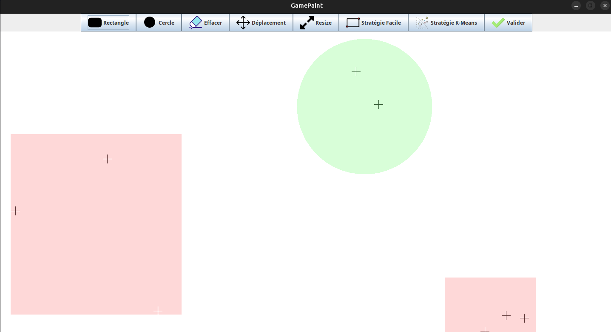

# 🎨 PaintJava – Jeu de dessin stratégique



## 📄 Description courte
Jeu de dessin stratégique développé en Java où l'objectif est de recouvrir l'ensemble des points affichés à l'écran en utilisant le moins de formes géométriques possible. Grâce à une interface interactive, le joueur peut créer, déplacer, redimensionner et supprimer des rectangles et des cercles pour optimiser son score.

---

## 📖 Description détaillée
PaintJava est une application de bureau interactive développée en Java qui combine manipulation graphique et réflexion logique. Le but principal est de résoudre un puzzle spatial en recouvrant la totalité des cibles (points) disséminées sur la zone de dessin tout en minimisant le nombre total de formes utilisées.

Le projet met en œuvre une gestion fluide de l'interface utilisateur et des événements de la souris (cliquer-glisser, molette pour le redimensionnement dynamique des cercles, sélection et suppression). Il sert de démonstration pratique de la programmation orientée objet en Java, de la gestion du rendu graphique 2D et des calculs d'intersection géométrique.

---

## ✨ Fonctionnalités du projet
- 📐 **Création dynamique de formes** : Génération intuitive de rectangles (par étirement) et de cercles (définition du centre puis du rayon).
- 🔄 **Manipulation interactive** : Déplacement et repositionnement à la souris de n'importe quelle forme présente sur le canevas.
- 📏 **Redimensionnement sur-mesure** : Ajustement de la taille des rectangles par étirement et contrôle précis du rayon des cercles via la molette de la souris.
- ❌ **Suppression rapide** : Suppression d'une forme en un simple clic.
- 🎯 **Algorithme de validation/score** : Détection de couverture des points cibles pour valider la réussite de la partie.

---

## 🎮 Lancer le jeu

Assurez-vous d’avoir Java installé sur votre système, puis exécutez la commande suivante dans un terminal :

```bash
java -jar "GamePaint.jar"
```

---

## 🖌️ Contrôles et interactions

### ▶️ Créer une forme
- **Rectangle :** Cliquez une fois, maintenez le clic, puis déplacez la souris jusqu'à la taille désirée avant de relâcher.
- **Cercle :** Cliquez une première fois pour définir le centre, puis une seconde fois pour fixer le rayon.

### 🔄 Déplacer une forme
- Cliquez sur une forme, maintenez le clic et faites-la glisser à l'endroit souhaité.

### 📏 Redimensionner une forme
- **Rectangle :** Cliquez, maintenez et étirez la forme.
- **Cercle :** Cliquez sur un cercle, maintenez le clic, puis utilisez la molette de la souris pour modifier son rayon.

### ❌ Supprimer une forme
- Cliquez simplement sur une forme pour la supprimer.

---

## 📄 Licence

Projet réalisé dans un but pédagogique et de démonstration.